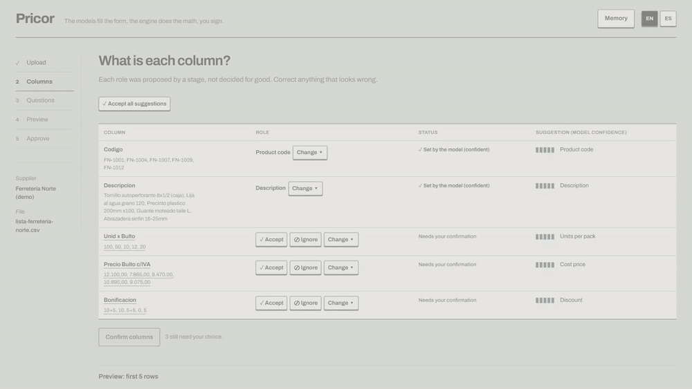
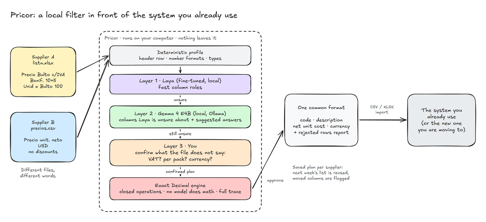

# Pricor

Pricor turns heterogeneous supplier price lists (Excel/CSV) from Argentine stores into one normalized catalog that the store's own system can import. Local models propose what each column means and suggest answers to what the file does not say; a deterministic engine runs the resulting plan with exact decimal math, so no model ever touches the numbers.

> The models fill the form, the engine does the math, you sign.



## How it works

<picture>
  <source media="(prefers-color-scheme: dark)" srcset="docs/media/pricor-filter-dark.png">
  
</picture>

1. **Profile.** Deterministic code finds the header row, number formats and column types.
2. **Classify.** A cascade proposes a role for each column: the fine-tuned Laya classifier (optional), then Gemma 4 E4B through Ollama, then you. A stage settles a column only at or above its calibrated confidence; everything else moves on.
3. **Ask.** Deterministic questions cover what the file does not say: VAT included, price per pack, discounts, currency and exchange rate. Gemma may suggest an answer; nothing is applied until you answer.
4. **Calculate.** A closed catalog of operations runs with Python `Decimal`. The preview shows every step from the original cell to the final cost.
5. **Approve and export.** You get the products file plus a rejected-rows report. The approved plan is saved per supplier, so next week's list reuses it and only moved, new or missing columns are asked again.

Around that flow: a price-change report between consecutive lists, an output format defined from your own template, and semantic memory for notes you choose to keep.

Everything runs on your computer. The only outbound request is an optional one to [DolarAPI](https://dolarapi.com) for the USD→ARS rate when a list needs converting, and that rate can be typed by hand instead.

**Status:** a research prototype. It has been tested on public lists from six Argentine distributors, not yet with a store using it every week. The classifier comparison and its limits are in [docs/benchmark.md](docs/benchmark.md); on that data most uncertain columns still go to the user, which is the intended behavior.

## Quick start

Requires Python 3.13 with [uv](https://docs.astral.sh/uv/), Node 22 with npm, and [Ollama](https://ollama.com) with the `gemma4:e4b` model pulled (`bge-m3` too for semantic memory).

```text
# 1. Start Ollama with flash attention off (gemma4:e4b crashes with it on the tested setup)
OLLAMA_FLASH_ATTENTION=0 ollama serve

# 2. Build the web app once (the build output is generated, not committed)
npm --prefix web ci
npm --prefix web run build

# 3. Run Pricor: it serves the app and opens your browser
uv run pricor
```

`pricor` listens on `http://127.0.0.1:8000` (a free port is used if 8000 is busy) and opens the browser once the server is up. Use `pricor --no-browser` to skip the browser, `--port N` to choose the port. If you start it before building the web app, `/` shows how to build it and the API keeps working.

Without Ollama the import still works: Gemma is skipped, you confirm the columns and answer every question yourself, and the page says so.

For front-end development, run `uv run pricor --no-browser` and, in another terminal, `npm --prefix web run dev` (http://localhost:5173; API calls are proxied to port 8000, set `PRICOR_API` to proxy elsewhere).

## Running the tests

```text
uv run pytest                    # backend
npm --prefix web run test        # front end
uv run pytest -m live -s         # opt-in smoke tests against a running Ollama
```

## Configuration

All settings are environment variables; every one has a working default.

| Variable | Default |
|---|---|
| `PRICOR_DB` | `%LOCALAPPDATA%\Pricor\pricor.db` on Windows, `$XDG_DATA_HOME/pricor/pricor.db` if set, otherwise `./pricor.db` |
| `PRICOR_OLLAMA_URL` | `http://localhost:11434` |
| `PRICOR_OLLAMA_MODEL` | `gemma4:e4b` |
| `PRICOR_OLLAMA_TIMEOUT` | `180` (seconds per model call) |
| `PRICOR_EMBED_MODEL` | `bge-m3` |
| `PRICOR_MEMORY_TOP_K` | `3` (memories retrieved for Gemma; a positive integer) |
| `PRICOR_LAYA_MODEL` | `models/laya-pricor` |
| `PRICOR_LAYA_DEVICE` | `auto` (CUDA when available, otherwise CPU; `cpu` and `cuda` force one) |
| `PRICOR_CALIBRATION` | the thresholds file shipped in the package (`src/pricor/entrypoints/thresholds.json`) |
| `PRICOR_FX_RATE_TYPE` | `oficial` (rate type suggested for conversion: `oficial`, `blue`, `bolsa`, `contadoconliqui`, `mayorista`, `cripto`, `tarjeta`) |
| `PRICOR_FX_TIMEOUT` | `10` (seconds per DolarAPI request) |

`gemma4:e4b` crashes with flash attention on the tested setup (`fattn.cu:110`), hence `OLLAMA_FLASH_ATTENTION=0` in the quick start.

### Models and safety

**Model output is never executed.** A model can only pick a role for a column from a closed list, suggest an answer to a question, or propose a source for an output column. Questions and their options are deterministic, a suggestion is never applied until the user answers, and the import plan is built and run by deterministic code with exact decimal math.

If Ollama is down, slow or returns something invalid, the import continues with the stages that still work (Laya or the keyword heuristics): the user confirms the uncertain columns, every open plan parameter is asked, and the session shows a `model_unavailable` notice.

The confidence thresholds that decide which columns are shown to the user are calibrated on a validation set (`src/pricor/entrypoints/thresholds.json`); a stage without a calibrated threshold keeps a 0.75 placeholder. Method, results and limits are in [docs/benchmark.md](docs/benchmark.md).

### Storage (SQLite)

Sessions, approved supplier plans, the price history, the output format and memories live in one SQLite file (standard library `sqlite3`, no server). The schema is versioned (`schema_version` table) and migrated at startup; a file written by a newer Pricor is refused. Approving an import stores the plan version, the accepted records and the session state in a single transaction. Plans are never overwritten: each approval adds a version. Prices are stored as exact decimal text.

### Excel percentages

Native Excel percentage cells retain their meaning in XLSX, XLSM and XLS: a stored `0.21` with a percentage format is read as `21.00%`, not `0.21%`. The conversion uses the stored value without rounding to the displayed precision. Ordinary decimal prices, text percentages and CSV cells are unchanged. A literal percent sign (quoted or escaped in a number format) does not scale a number.

## HTTP API

The web app talks to a FastAPI server; the same API can be used directly.

```text
uv run pricor serve --no-browser         # http://127.0.0.1:8000, interactive docs at /docs
uv run uvicorn pricor.entrypoints.wiring:app_from_env --factory --port 8000
```

The import flow and every endpoint are documented in the docstring of [src/pricor/entrypoints/api.py](src/pricor/entrypoints/api.py) and at `/docs`. Uploads accept `.csv`, `.xlsx`, `.xlsm` and `.xls` up to 20 MB. Errors use one envelope: `{"error": {"code": "...", "message": "..."}}`.

- `POST /sheets` (multipart `file`): inspects a workbook and returns `{"sheets": [...]}` with its sheet names (CSV files return a single sheet named after the file stem). Shares the size limit, allowed extensions and error envelope with `POST /imports`.
- `GET /imports/{id}/sample?limit=5`: returns `{"header": [...], "rows": [[...], ...]}` with the first data rows of the sheet under their original headers, skipping preamble, empty, section and total rows as classified by the profiler. `limit` is validated between 1 and 20 (default 5); returns 404 for an unknown session.
- `POST /imports/{id}/questions/{question_id}/ask`: optional, read-only Gemma help for an open or answered question. Send `{"message": "Does this mean VAT is included?", "history": [{"role": "user", "text": "What is VAT?"}, {"role": "model", "text": "A tax on the price."}]}`. The message is trimmed and must have 1–500 characters; the optional history holds at most 6 earlier turns of the same question (`user` or `model`), each at most 1,200 characters. Returns `{"reply": "...", "suggested_option": "yes"}` (or `null` for no suggestion) in the import's question language. Replies are non-empty and at most 1,200 characters, and suggestions must match an existing option token. Unknown sessions or unasked questions return 404; invalid bodies 422; unavailable models or invalid model replies 503 with code `model_unavailable`. The conversation is untrusted context, never executed or saved as memory; only `POST /imports/{id}/answers` confirms an answer and changes the plan.

### Exports

Once a session is approved, `GET /imports/{id}/export?format=csv|xlsx` returns the products and `GET /imports/{id}/rejected?format=csv|xlsx` the rejected-rows report (409 before approval).

- Standard columns, in this order: `supplier_code, description, unit_cost_net, currency, vat_rate, units_per_pack, barcode, suggested_retail_price`, then `source_row` (the row number in the supplier's file). The rejected report is `source_row, reasons`, then the original cells under the file's own headers.
- CSV: UTF-8 with BOM, `,` delimiter, CRLF, RFC 4180 quoting, `.` as decimal separator, values written as exact text (`855.00`). Excel with a `;` list separator (es-AR) splits `;` CSVs by default; use `CsvExporter(delimiter=";")` if that is your setup. Excel drops the leading zeros of codes in CSV files it opens directly: use the XLSX export for that.
- XLSX: sheets `Products` and `Rejected rows` (the standalone rejected report has only the second one). Codes, barcodes and original cells are text cells; prices and rates are numeric cells. A number with more than 15 significant digits is written as text instead of being rounded.
- Text that spreadsheet software could run as a formula (`=`, `+`, `-`, `@` at the start) is stored as text in XLSX and prefixed with `'` in CSV; plain numbers such as `-123` are left alone.

### Output format from a template

Upload a CSV/XLS/XLSX template to define the products file your store needs. There is one format for the whole store, shared by all suppliers and imports. The first non-empty row supplies the column names, in their original order; blank names become `Column N` (1-based). Up to five following rows are samples; the number of columns comes from the header and those samples only. An empty file returns 422. The optional `sheet` selects a workbook sheet.

- `POST /output-format` (multipart `file`, optional `sheet`) returns 201 and **replaces** the saved template in `proposed` state. It is not active yet.
- `GET /output-format` returns 200 with the saved format, or 404 if absent.
- `PUT /output-format/mapping` confirms every column with `{"sources": ["field:supplier_code", "empty", "constant:My store"]}` in column order. A wrong count, unknown field or invalid constant returns 422 without changing the saved format; no saved format returns 404. Fixed text must be non-blank and 1–200 characters; it is preserved verbatim.
- `PUT /output-format` saves a column list the user defined, already confirmed: `{"columns": [{"name": "SKU", "source": "field:supplier_code", "template_index": 0}]}`. The products file then has exactly these columns, in this order; every other field is left out. Names are required, at most 100 characters and unique ignoring case. `template_index` (optional) links a column to a column of the saved template so it keeps its samples and proposal; columns added by hand have none and `proposed_by: "user"`. An invalid list returns 422 without changing the saved format. A list with no template column has an empty `name`.
- `DELETE /output-format` removes the format and returns 204.

POST, GET and both PUTs return the same shape:

```json
{
  "name": "template.xlsx",
  "state": "proposed",
  "fields": ["supplier_code", "description", "unit_cost_net", "currency", "vat_rate", "units_per_pack", "barcode", "suggested_retail_price", "unit_cost_net_converted", "fx_rate", "fx_source", "fx_date", "source_row"],
  "columns": [{"index": 0, "name": "SKU", "samples": ["001"], "proposal": {"source": "field:supplier_code", "proposed_by": "gemma", "confidence": 0.8}, "source": null}]
}
```

Each source is `field:<name>` from `fields`, `empty`, or `constant:<text>`. Gemma proposes a source with structured output checked against this closed list; invalid replies or an unavailable Gemma fall back to deterministic header heuristics (`proposed_by: "heuristics"`; unmatched names propose `empty`). Confidence is an uncalibrated estimate, not a measured probability. The model never executes anything or activates a mapping: review every column, enter or edit fixed values, then confirm. A field may feed more than one output column. After confirmation, `state` is `confirmed` and each column's `source` holds its confirmed value; proposals remain visible for comparison.

A confirmed format changes only the product CSV/XLSX columns, names and order, using the existing exact number/text and formula-safety rules. Unavailable optional fields and `empty` sources yield empty cells; fixed values are text. Without a confirmed format, exports use the standard format. Uploading a new template returns exports to the standard format until confirmation; deleting also restores it. An approved import keeps the layout that was in force when it was approved: changing or removing the format later never changes its downloads. Rejected-row downloads and the XLSX rejected sheet never change.

### Semantic memory

Memories are created only when you explicitly save a note or accept a Gemma suggestion ("Remember this"); Pricor never creates them automatically. Relevant memories are retrieved as context for later Gemma suggestions, which cite the notes they used. Embeddings come from a local model (`ollama pull bge-m3`).

- `GET /memories` lists memories.
- `POST /memories` creates a note with `{"text": "...", "supplier_name": "..."}` or saves an accepted Gemma suggestion with `{"session_id": "...", "question_id": "..."}`.
- `PATCH /memories/{id}` replaces its text with `{"text": "..."}`.
- `DELETE /memories/{id}` deletes it and returns 204.

## Laya column classifier (optional)

The column classifier can be fine-tuned locally on a CUDA GPU (about 6 GB of VRAM). The base install does not include torch; the `laya` extra adds `laya==0.4.6` and the CUDA 12.6 build of torch 2.14.1:

```text
uv sync --extra laya
uv run python -c "import torch; print(torch.cuda.is_available())"
```

How the training data is built, how the split by distributor works and how to train and evaluate are in [tools/laya/README.md](tools/laya/README.md). Fine-tuned weights are not published.

With the extra installed and a fine-tuned model in place, Laya is the first stage of the cascade (Laya, then Gemma, then the user). Without the extra or the model the Laya stage is skipped, the session shows a `model_unavailable` notice saying why, and the keyword heuristics take its place as the first stage.

## Research corpus and benchmark

The benchmark and the Laya training use public price lists that distributors link from their own websites. Only their URLs ([data/sources.json](data/sources.json)) and hand-assigned column labels (headers only) are committed; the files themselves are downloaded locally into the gitignored `data/raw/`:

```text
uv run python -m tools.corpus.download                 # one request per listed file
uv run python -m tools.corpus.simulate_week <file>     # a clearly labeled SIMULATED "next week" list
uv run python -m tools.benchmark --help                # collect, calibrate, compare cascades, write docs/benchmark.md
```

## Project layout

The backend follows a ports-and-adapters layout; the domain has no I/O, and `tests/test_layering.py` checks the import direction between layers.

| Path | Content |
|---|---|
| `src/pricor/domain` | Profiling, plan, operations catalog and the exact `Decimal` engine |
| `src/pricor/application` | Use cases: first import, classifier cascade, questions, reuse, price report, memory, output format |
| `src/pricor/ports` | Interfaces the application depends on |
| `src/pricor/adapters` | Spreadsheet reading, Gemma/Ollama, Laya, heuristics, SQLite, exporters, DolarAPI |
| `src/pricor/entrypoints` | FastAPI app, CLI and wiring |
| `web` | React + Vite + TypeScript front end (English and Spanish) |
| `tools` | Corpus download, Laya training and the benchmark |
| `tests` | Backend and tooling tests, plus opt-in live tests against Ollama |

## License

Copyright 2026 The Pricor Authors. Licensed under Apache-2.0; see [LICENSE](LICENSE).
